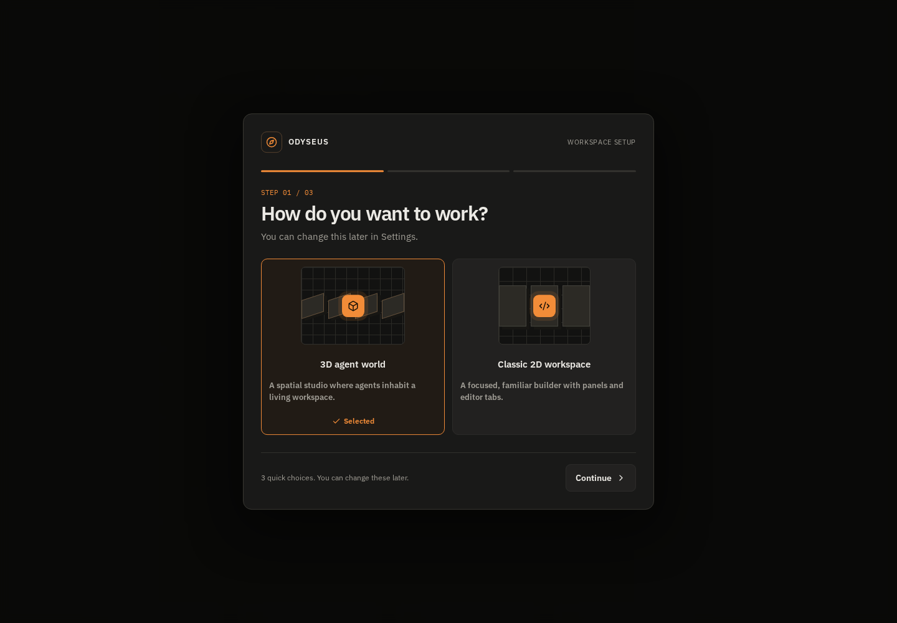

# Odyseus Nexus Pro

Odyseus Nexus Pro is an AI-assisted software-building workspace for turning project goals into code, then reviewing and refining the result. The repository contains a React/Vite web interface, an Express API, and an Electron desktop build.

> **Project status:** actively developed. Some workflows depend on external API keys or provider adapters that must be configured separately. A visible control is not proof that a remote integration is connected.

## Workspace screenshot

<!-- This image is captured from the built application by GitHub Actions. It is not a mockup. -->


The screenshot is generated from the checked-in source using Chromium in GitHub Actions and refreshed after relevant pushes to `main`. It shows the default workspace, not a claim that every external service is configured.

## What is included

- **Project builder UI:** project context, prompt-driven build workflow, file workspace, and preview areas.
- **AI assistance:** Gemini-backed generation and refinement when the required server-side API key is configured.
- **Developer tools:** task composition, activity logs, debugging and formatting endpoints, and a CI/CD status interface.
- **Project utilities:** browser-local settings persistence, a JSON project archive export, and a local asset manager for image, SVG, and JSON files.
- **Deployment configuration checks:** reports whether required provider environment variables exist. This check does **not** verify remote credentials or deploy an application.
- **Desktop packaging:** Electron build targets for Windows, macOS, and Linux through GitHub Actions.

## Current integration boundaries

Please don't mistake a polished button for a magical backend. The following require additional configuration or implementation:

- **AI generation:** configure `GEMINI_API_KEY` on the server.
- **Billing:** checkout and server-side purchase verification must be implemented and configured before paid plans can be activated.
- **Deployment providers:** provider-specific adapters and server-side credentials are required. A configuration check alone does not deploy.
- **Asset storage:** the Asset Manager currently previews files locally in the browser session; it does not upload them to cloud storage.
- **Settings:** user preferences are stored in the current browser's local storage, not synced to an account.
- **Mobile:** a native iOS/Android application is a roadmap item, not a released app.

## Tech stack

- **Frontend:** React, TypeScript, Vite, Tailwind CSS
- **State:** Zustand
- **Motion:** Motion
- **Icons:** Lucide React
- **Backend:** Express and TypeScript
- **AI SDK:** Google GenAI
- **Authentication/data:** Firebase integration points
- **Desktop:** Electron and electron-builder
- **CI:** GitHub Actions builds on Ubuntu, Windows, and macOS

## Getting started

### Requirements

- Node.js 20 or newer
- npm
- A Gemini API key for AI-powered generation

### Install and run

```bash
git clone https://github.com/Liladizilla/NEXUS_PRO_01.git
cd NEXUS_PRO_01
npm ci
npm run dev
```

The development command starts the Express application. Use the Vite scripts below when you specifically need the frontend development server or a production-style frontend preview.

```bash
# Frontend development server
npx vite --host 127.0.0.1

# Build the frontend
npm run build

# Preview the built frontend
npm run preview

# TypeScript check
npm run lint

# Build the desktop packages
npm run electron:build
```

Configure secrets in the server environment. Do not place private provider credentials in frontend variables or commit them to the repository.

## Desktop builds

GitHub Actions builds desktop packages on native runners for Windows, macOS, and Linux. Open the [Actions page](https://github.com/Liladizilla/NEXUS_PRO_01/actions) to inspect the latest build and download available workflow artifacts.

Published installers should be downloaded from [GitHub Releases](https://github.com/Liladizilla/NEXUS_PRO_01/releases) when a release exists. Workflow artifacts are not the same thing as a published release.

## Repository layout

```text
src/
  components/features/   Main workspace features
  core/                  State, AI and Firebase integration
  styles/                Design system and theme styles
server/                  Express API and service logic
api/                     Serverless API handlers
electron/                Electron entry points and assets
scripts/                 Build helpers
docs/                    Architecture notes and screenshots
.github/workflows/       CI and screenshot capture
```

## Contributing and verification

1. Create a feature branch.
2. Run `npm ci`, `npm run lint`, and `npm run build` where applicable.
3. Describe which integrations were actually exercised and which require credentials.
4. Include screenshots captured from the running build when changing UI. Do not use fabricated screenshots as evidence of working behavior.

See [Architecture](docs/ARCHITECTURE.md) and [API specification](docs/API_SPEC.md) for additional context.

## License

See the repository's license file for the applicable terms.
